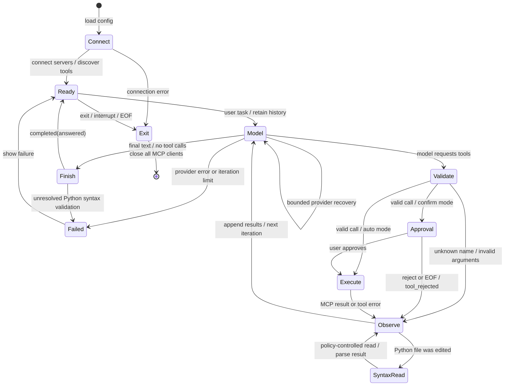
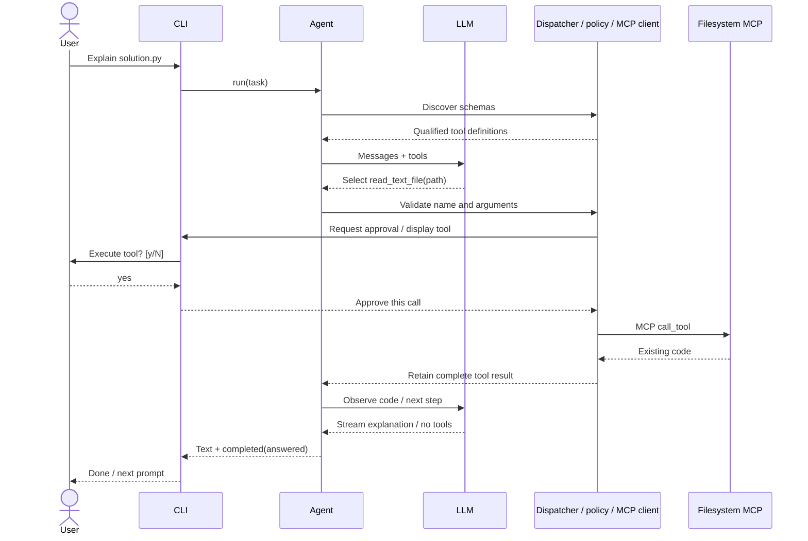
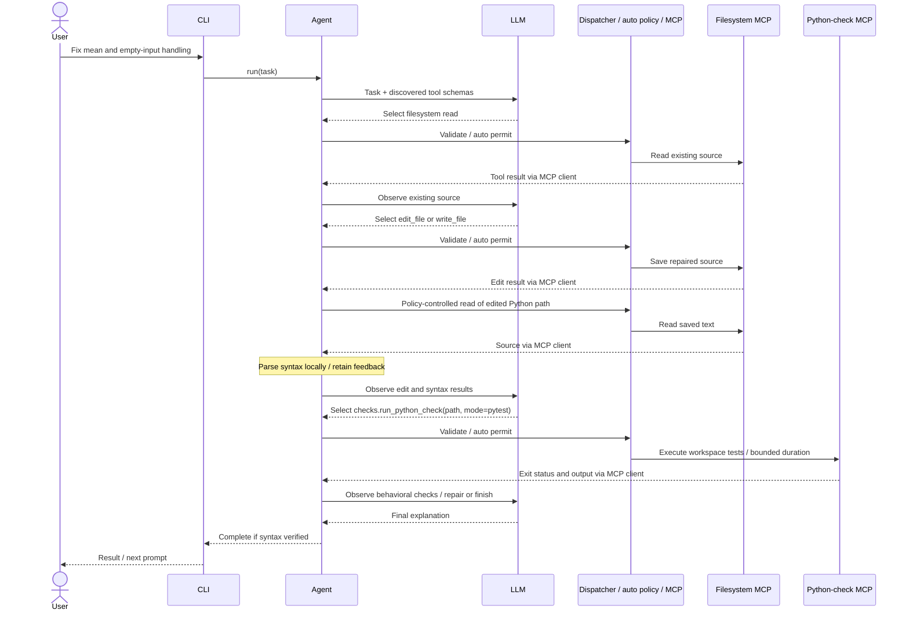
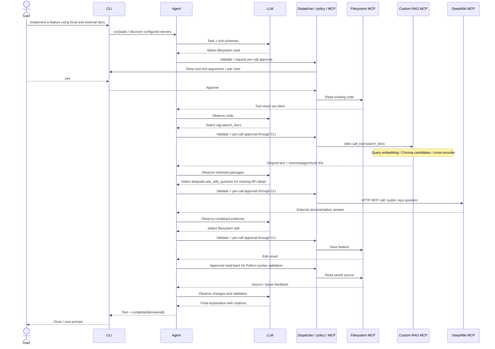

# Final architecture and workflow diagrams

The original planning diagram is preserved in [its original PDF](../init-architecture.drawio2.pdf)
and on page 5 of [PROJECT_REPORT.pdf](../PROJECT_REPORT.pdf). The updated component
diagram and the reasons for changes are on page 6. Pages 7-10 contain static vector
versions of the state and three sequence diagrams below. These describe implemented
control flow and example tool choices; they are not recorded successful live runs.

## State diagram: one task in the interactive session

Syntax validation runs once after each edited path in a tool batch, not recursively
after its own read. Rejected or failed reads leave syntax unverified. The 40-step
agent limit and bounded Groq retries prevent unbounded model/tool loops.

## Operation 1: inspect and explain existing code (confirmation)

Rejection follows the state diagram's `tool_rejected` branch without an FS call.

## Operation 2: repair a Python bug (automatic)

Invalid saved syntax is fed back for repair. Unresolved syntax prevents normal
completion. The separate check tool executes trusted workspace code; tests prove
only the behavior they actually check. This tool was added after the historical
coding comparison, whose evaluator-owned tests were separate.

## Operation 3: documentation-assisted feature (confirmation)

All valid calls require approval in confirmation mode, including retrieval and
syntax-check reads. The model selects order and tools; a real run can instead
decline, fail, or need more iterations. DeepWiki is hosted; filesystem and RAG
are local stdio processes. A fourth local stdio server executes Python checks, as
shown in operation 2. No arbitrary shell interface is exposed by this configuration.
